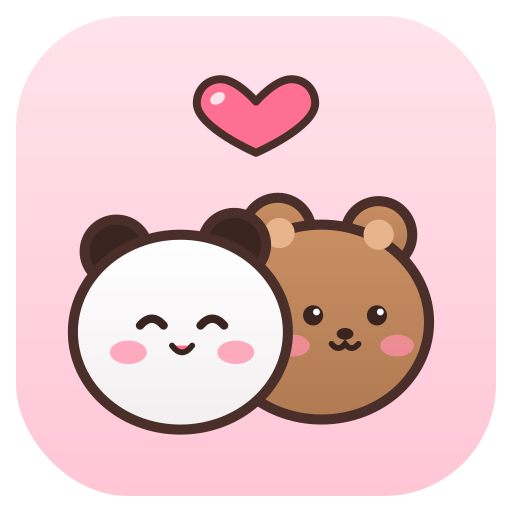

<p align="center"></p>

# Yier & Bubu desktop pet

一二 (Yier, the white panda) and 布布 (Bubu, the brown bear) live on top of your Windows taskbar.
They walk around, react when you click them, can be picked up and dropped, come together for a hug
every now and then, and fall asleep when you've been away from the PC for a while. They can also be
your alarm clock and timer, and let you know about notifications, the battery and more.

> **Unofficial fan project.** Yier & Bubu (一二布布) belong to their creators. This repository contains
> no character artwork. On first run the app offers to download a starter set of stickers from
> [Tenor](https://tenor.com), for your personal use.

## Download

Get the latest version from [Releases](https://github.com/lesyhau/yier-bubu-pet/releases/latest).

**Installer (recommended):** `YierBubuPet-<version>-setup-x64.exe` for most PCs (Intel/AMD), or
`...-setup-arm64.exe` for ARM PCs (Snapdragon, Surface Pro X). It installs for your user account
without needing admin rights, adds a Start menu entry, can start the pets when you sign in, and can
be removed from **Settings → Apps**.

**Portable exe:** `YierBubuPet-win-x64.exe` / `YierBubuPet-win-arm64.exe`. Put it in a folder of its
own (an `animations` folder is created next to it) and run it.

Nothing else needs to be installed. Windows may say "Windows protected your PC" because the files aren't
code-signed; click **More info → Run anyway**.

Works on Windows 10 and 11 (developed on Windows 11).

## Building from source

Needs the [.NET 8 SDK](https://dotnet.microsoft.com/download/dotnet/8.0).

```
git clone https://github.com/lesyhau/yier-bubu-pet.git
cd yier-bubu-pet
dotnet publish src\YierBubuPet -c Release -o app
app\YierBubuPet.exe
```

Or open `YierBubuPet.sln` in Visual Studio. Dev builds use the `animations\` folder at the repository root.

To build a single self-contained exe like the ones on the Releases page (use `win-arm64` for ARM):

```
dotnet publish src\YierBubuPet -c Release -r win-x64 --self-contained -p:PublishSingleFile=true -p:IncludeNativeLibrariesForSelfExtract=true -p:EnableCompressionInSingleFile=true -o dist\win-x64
```

On first run, the app sees that `animations\` is empty and offers to download the starter pack
(76 stickers, about 5 MB). You can also run that download from the control panel, or from the command line:

```
app\YierBubuPet.exe --starter-pack animations
```

### Building the installer

Needs [Inno Setup 6](https://jrsoftware.org/isdl.php) (6.3 or newer) as well. In PowerShell:

```
.\installer\build.ps1                    # x64
.\installer\build.ps1 -Arch x64, arm64   # both
```

This publishes the single-file exe to `dist\win-<arch>\` and compiles
[`installer/YierBubuPet.iss`](installer/YierBubuPet.iss) into `dist\YierBubuPet-<version>-setup-<arch>.exe`.
The version comes from `<Version>` in `src/YierBubuPet/YierBubuPet.csproj`. You can also open the
`.iss` file in the Inno Setup IDE and compile it there after publishing.

Where things go when installed:

| What | Where |
|---|---|
| The app | `%LocalAppData%\Programs\YierBubuPet` (or `Program Files\YierBubuPet` if you choose "all users") |
| Animations and the alert sound | `animations\` next to the app; for an all-users install, `%LocalAppData%\YierBubuPet\animations` |
| Settings | `%AppData%\YierBubuPet\settings.json` |

Uninstalling asks whether to delete the animations folder too; by default it's kept.

## Using it

- **Click** a pet to make it react.
- **Drag** a pet to pick it up; let go and it falls back down to the taskbar.
- **Click the tray icon** or **right-click a pet** to open the control panel:
  - **Together time 💕**: they walk to each other and play a "together" animation
  - **Bedtime 💤 / Wake up** and **Hide / Show**. They also fall asleep by themselves after 5 minutes without keyboard or mouse input.
  - **Alarms & timers**: add alarms (once, every day, or on weekdays, with a message) and timers (5, 10, 25, 60 minutes or your own)
  - **Alerts**: choose what Yier tells you about (see below), and **Try it** to preview
  - **Settings**: size, walking area (whole screen / left half / right half; you can still drag them anywhere and they walk back),
    language (automatic / English / Tiếng Việt), start with Windows
  - **Animations**: open the folder, reload, download the starter stickers
  - **ⓘ** About and **Support the developer ❤**, **⏻** Exit

Settings, alarms included, are saved in `%AppData%\YierBubuPet\settings.json`.

## Alerts

When something happens, Yier stops, plays the alert animation with its sound, and says what it is in a
speech bubble. Click Yier or the bubble to dismiss it.

| Alert | When | Rings until clicked |
|---|---|---|
| Alarm, timer | at the time you set | yes (gives up after 3 minutes) |
| Notifications from other apps | a notification pops up (Zalo, Teams, Outlook, the Windows Clock app, ...) | no |
| Every hour | on the hour | no |
| Battery low | the battery drops to 20% while unplugged | yes |
| Charger | the charger is plugged in or unplugged | no |
| Unlock | you unlock the PC | no |

Alarms, timers and low battery always show, even when the pets are hidden. The other alerts are skipped while
the pets are hidden or you're away from the PC.

The animation and sound come from **`animations\alert\`**: put one animated sticker and one sound file
(**WAV, MP3, WMA or M4A**) there. The starter pack puts a sticker there; add your own sound. To use a different
animation or sound for one kind of alert, put it in a sub-folder named after it: `alert\alarm`, `alert\timer`,
`alert\notification`, `alert\hourly`, `alert\battery`, `alert\charger` or `alert\unlock`.

**About notifications from other apps:** Windows only lets Store apps read notifications, so the app watches for
the notification pop-up appearing instead. It can't see notifications while **Do not disturb** / Focus is on (no
pop-up is shown), and it doesn't know which app sent one.

## Adding your own animations

Animations are plain files in `animations\`. The folder decides when each one is used:

| Folder | Used when |
|---|---|
| `yier\idle`, `bubu\idle` | standing around (a character appears once it has at least one idle animation) |
| `yier\walk`, `bubu\walk` | walking (mirrored automatically to face the walking direction) |
| `yier\click`, `bubu\click` | clicked, and sometimes just for fun |
| `yier\drag`, `bubu\drag` | being carried or falling |
| `yier\sleep`, `bubu\sleep` | asleep, when there's no `together\sleep` animation |
| `together\play` | hugging or playing together (one file showing both characters) |
| `together\sleep` | sleeping together |

Supported formats are **GIF, animated WebP and PNG**. Drop a file into a folder and it's picked
up within a couple of seconds, with no restart needed.

- Transparent stickers look best. GIFs on a plain white (or other single-colour) background work too,
  because the background is removed automatically. GIFs with a full scene behind the characters are kept as a rectangle.
- Empty space around the character is trimmed, and everything is scaled to the same height, so any size works.
- Walk animations are assumed to face left (or the viewer). If one faces right, put `[right]` in its file name.

### Previewing animations

To preview how a file will be processed (background removed, trimmed), write its frames out as PNGs:

```
app\YierBubuPet.exe --dump some.gif out_folder
```

### Finding more stickers

`tools\fetch_tenor.py` (Python 3, no extra packages) downloads transparent stickers from a Tenor search into `incoming\`:

```
python tools\fetch_tenor.py "bubu dudu dance" --limit 20
```

Look through them and move the ones you like into the right folder. In English the characters are
usually tagged "bubu dudu". Try "bubu dudu sleep", "bubu dudu hug", "bubu dudu walk" or "yier bubu".

## How it works

```
YierBubuPet.sln
src/YierBubuPet/        the app
assets/logo/            app logo (SVG source; tools/make_icon.py renders the .ico and PNGs)
assets/donate/          donation QR code (tools/make_qr.py)
installer/              Inno Setup script and build script
tools/                  sticker downloader, icon and QR generators
animations/             your animations and the alert sound (not in git)
```

Inside `src/YierBubuPet/`:

| File | Role |
|---|---|
| `Program.cs` | Entry point, single-instance check, command-line options, finding the animations folder |
| `Stage.cs` | Frame loop, bringing the pets together, sleep/wake, showing alerts, tray icon |
| `Settings.cs` | Saved settings and alarms |
| `Pets/Pet.cs` | One character's behaviour: idle → walk → react, dragging and falling |
| `Pets/SpriteWindow.cs` | A borderless, transparent, always-on-top window that plays one animation. Clicks pass through transparent pixels. |
| `Animation/AnimationLibrary.cs` | Finds animations (and alert sounds) by folder, decodes in the background, caches, reloads when files change |
| `Animation/ClipDecoder.cs` | Decodes GIF/WebP/PNG with [SkiaSharp](https://github.com/mono/SkiaSharp), removes solid backgrounds, trims and scales |
| `Alerts/` | What triggers alerts (alarms, timers, notifications, battery, ...), the alarm dialog and the speech bubble |
| `Audio/AlertSound.cs` | Plays the alert sound |
| `UI/` | The control panel and its building blocks (cards, toggles, buttons) |
| `About/AboutWindow.cs` | About window with links and the donation options (PayPal link, VietQR code) |
| `Localization/Strings.cs` | Menu and window text in English and Vietnamese |
| `StarterPack/` | The starter sticker list and its downloader |
| `Platform/` | Win32 calls, screens and DPI |
| `Resources/` | App icon and manifest |

## Support the developer

Yier & Bubu is free. If the pets make you smile, you can support development from **About → Support the developer**
in the control panel:

- **PayPal:** send to `le.sy.hau@outlook.com`
- **In Vietnam:** scan the QR code with your banking app (VietQR, Vietcombank)

<p></p>

## License

The code and the logo are [MIT](LICENSE) licensed. That doesn't cover the
characters or any downloaded artwork.
